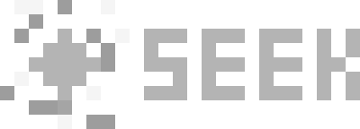

<a id="readme-top"></a>

<!-- PROJECT SHIELDS -->
<div align="center">
  <a href="https://github.com/piskevalee-cpu/Seek/graphs/contributors"></a>
  <a href="https://github.com/piskevalee-cpu/Seek/network/members"></a>
  <a href="https://github.com/piskevalee-cpu/Seek/stargazers"></a>
  <a href="https://github.com/piskevalee-cpu/Seek/issues"></a>
  <a href="https://github.com/piskevalee-cpu/Seek/actions/workflows/ci.yml"></a>
</div>

<!-- PROJECT LOGO -->
<br />
<div align="center">
  <a href="https://github.com/piskevalee-cpu/Seek">
    
  </a>

  <p align="center">
    A thin, local-first coding-agent harness for the terminal.
    <br />
    <a href="docs/SPEC.md"><strong>Explore the docs »</strong></a>
    <br />
    <br />
    <a href="docs/TESTING.md">View the test checklist</a>
    &middot;
    <a href="https://github.com/piskevalee-cpu/Seek/issues/new?labels=bug">Report Bug</a>
    &middot;
    <a href="https://github.com/piskevalee-cpu/Seek/issues/new?labels=enhancement">Request Feature</a>
  </p>
</div>

<!-- TABLE OF CONTENTS -->
<details>
  <summary>Table of Contents</summary>
  <ol>
    <li>
      <a href="#about-the-project">About The Project</a>
      <ul>
        <li><a href="#built-with">Built With</a></li>
      </ul>
    </li>
    <li>
      <a href="#getting-started">Getting Started</a>
      <ul>
        <li><a href="#prerequisites">Prerequisites</a></li>
        <li><a href="#installation">Installation</a></li>
      </ul>
    </li>
    <li><a href="#usage">Usage</a></li>
    <li><a href="#roadmap">Roadmap</a></li>
    <li><a href="#next-steps">Next Steps</a></li>
    <li><a href="#contributing">Contributing</a></li>
    <li><a href="#license">License</a></li>
    <li><a href="#contact">Contact</a></li>
    <li><a href="#acknowledgments">Acknowledgments</a></li>
  </ol>
</details>

<!-- ABOUT THE PROJECT -->
## About The Project

SEEK wraps a model with a short prompt, a small toolset and a terminal UI. The model is yours: a
local llama.cpp server, an Anthropic model, or anything that speaks the OpenAI chat protocol. The
first screen is the chat, with `[no model selected]`; choose one with `/model` when you are ready.

```
╭ [no model selected] ──────────────────────────────────────────────────────────────────────────╮
│ add a test for the parser                                                                     │
╰───────────────────────────────────────────────────────────────── Enter sends · Alt+Enter newline ╯
 ASK  [no model selected]  user/project develop ~0 / 0 0%0.0 t/s cpu -  ram -
```

Here is why it exists:

* **Thin by design.** A short prompt, five default tools, and no hidden machinery. The system
  prompt plus its tool schemas fits in a 1,500-token budget, checked in CI.
* **Local is a first-class citizen.** SEEK discovers models in `~/seek/models/`, starts
  `llama serve`, waits for the health check, reads the real context size and stops the server on
  exit.
* **Model-agnostic.** Switch between local and cloud models between turns without losing the
  conversation.
* **Filesystem is configuration.** Skills, tools, models and widgets live in `~/seek/` as plain
  folders and files.
* **The agent can search.** `web_search` is on by default and takes a query, not a URL.
* **Nothing hidden.** Logs, process ids, context use and speed are always reachable.

<p align="right">(<a href="#readme-top">back to top</a>)</p>

### Built With

* [Rust](https://www.rust-lang.org/) (edition 2024, MSRV 1.88)
* [ratatui](https://ratatui.rs/) and [crossterm](https://github.com/crossterm-rs/crossterm) for the TUI
* [tokio](https://tokio.rs/) for the event loop and the agent task
* [reqwest](https://github.com/seanmonstar/reqwest) for the provider APIs and streaming
* [llama.cpp](https://github.com/ggml-org/llama.cpp) for local inference

<p align="right">(<a href="#readme-top">back to top</a>)</p>

<!-- GETTING STARTED -->
## Getting Started

### Prerequisites

* Rust 1.88 or newer (`rustup` is fine).
* `git` on `PATH` for the `git` home widget.
* The `llama` binary on `PATH` if you want local models. Models live in `~/seek/models/` or
  `~/LLMs/`; building llama.cpp from source also needs cmake and a C/C++ compiler.

### Installation

1. Clone the repository.
   ```sh
   git clone https://github.com/piskevalee-cpu/Seek.git
   cd Seek
   ```
2. Build and install the binary and the `~/seek/` folders.
   ```sh
   ./install.sh --from-source
   ```
   Or build by hand: `cargo build --release -j 2` (the build uses little parallelism on purpose —
   a local server keeps a large KV cache in memory).
3. Check what SEEK found.
   ```sh
   seek --doctor
   ```
4. Start the chat and pick a model.
   ```sh
   seek
   # then type /model and press Enter
   ```

The first run asks for your name so the model can address you by it. No model picker is put in
front of the chat: the transcript is there from the first frame, with `[no model selected]` in the
footer and in the prompt border.

<p align="right">(<a href="#readme-top">back to top</a>)</p>

<!-- USAGE EXAMPLES -->
## Usage

**Pick a model.** `/model` opens a picker with the local models of `~/seek/models/` and the bundled
cloud catalog. The chosen model shows in the footer; the `LOCAL` tag is only in the picker (SPEC
10.2). Cloud keys go in the environment or `state/auth.json`, never in `config.toml`.

**Compose.** The prompt completes while you type, like the oh-my-pi composer:

* `/` completes the slash commands and the installed skills.
* `@` completes a file of the project: `@main` finds `src/main.rs` anywhere below the project
  root.
* A path such as `src/`, `./`, `../`, `~/` or `/tmp/` completes the entries of that directory.
* `↑` / `↓` move the selection, `Tab` accepts it, `Enter` accepts and runs a command, `Esc`
  closes the list. A file path is inserted with a trailing space so the message can go on.

**Search the web.** Ask a question; the agent calls `web_search` with a query and gets numbered
sources back. No URL is needed. The default chain is DuckDuckGo, Mojeek, Startpage and Ecosia;
keys for Brave, Tavily, Exa, Jina, Kagi and Firecrawl are read from environment variables or
`state/auth.json` (see [docs/SPEC.md](docs/SPEC.md) §9.3).

**Stay in control.** The footer shows `READ`, `ASK` or `YOLO`; `Tab` cycles the mode when the
sidebar is closed, or moves into it when it is open. In `ASK` mode a write, a command or a network
call asks first. `Ctrl+B` opens the sidebar with sessions, processes and metrics.

**Extend.** `/tools` and `/skills` are checklists. External tools live in `~/seek/tools/` and
widgets in `~/seek/widgets/`; both are plain files.

For the full list of keys and screens, see [docs/TESTING.md](docs/TESTING.md).

<p align="right">(<a href="#readme-top">back to top</a>)</p>

<!-- ROADMAP -->
## Roadmap

SEEK is built milestone by milestone from [docs/SPEC.md](docs/SPEC.md).

| Milestone | Scope | Status |
| --- | --- | --- |
| v0.1.0 | Workspace, CI, theme, logo, Home/Chat layout, prompt bar, spinners, footer, sidebar | done |
| v0.2.0 | Anthropic and OpenAI-compatible providers, reasoning variants, `/provider`, sessions | done |
| v0.3.0 | Agent loop, the tools, permissions, tool rows, processes list | done |
| v0.4.0 | llama.cpp supervisor, models folder, launch options, log strip | done |
| v0.5.0 | Context accounting, METRICS block, `/compact` | done |
| v0.6.0 | Skills, external tool format, toggles, `/init` | done |
| v0.7.0 | Home widgets, `install.sh`, rate limits, web search | done |
| v0.8.0 – v1.0.0 | Hardening, contract review, the contracts frozen | in progress |

See the [open issues](https://github.com/piskevalee-cpu/Seek/issues) for proposed features and
known gaps.

<p align="right">(<a href="#readme-top">back to top</a>)</p>

<!-- NEXT STEPS -->
## Next Steps

The three areas we want to grow next:

1. **Provider support.** More model providers and auth flows, with the same streaming interface:
   cloud APIs, local servers and gateways behind one catalog. Keys keep living in the environment
   or `state/auth.json`.
2. **Universal skills and tools.** Finish the skill and tool contracts so a `SKILL.md` or a
   `tool.toml` can be shared between harnesses without rewriting it: discovery, permissions,
   argument schemas and output stay portable (SPEC §9.3 and §9.5).
3. **Widgets.** Broaden the home-screen widgets — more built-ins, configurable layout and live
   data — while keeping the one-fact-one-home rule (SPEC §10.2 and §10.5).

<p align="right">(<a href="#readme-top">back to top</a>)</p>

<!-- CONTRIBUTING -->
## Contributing

Contributions are welcome. Read [docs/SPEC.md](docs/SPEC.md) first: it is the source of truth.
Branch rules, Conventional Commits, versioning and the checks to run before a pull request are in
[CONTRIBUTING.md](CONTRIBUTING.md).

1. Fork the repository.
2. Create a branch from `develop` (`git checkout -b feature/<scope>-<short-name> develop`).
3. Commit with a Conventional Commit (`feat(tui): add …`).
4. Run `cargo fmt --all`, `cargo clippy --workspace --all-targets -- -D warnings` and
   `cargo test --workspace` before pushing.
5. Push and open a pull request into `develop`.

Manual changes to the UI or the agent loop also need a walk through
[docs/TESTING.md](docs/TESTING.md).

<p align="right">(<a href="#readme-top">back to top</a>)</p>

<!-- LICENSE -->
## License

There is no license yet — the owner has not chosen one ([D-005](docs/DECISIONS.md)). Vendored and
ported code keeps its upstream license: oh-my-pi is MIT, grok-build is Apache-2.0.

<p align="right">(<a href="#readme-top">back to top</a>)</p>

<!-- CONTACT -->
## Contact

Project link: [https://github.com/piskevalee-cpu/Seek](https://github.com/piskevalee-cpu/Seek)

Questions and bugs: [GitHub Issues](https://github.com/piskevalee-cpu/Seek/issues).

<p align="right">(<a href="#readme-top">back to top</a>)</p>

<!-- ACKNOWLEDGMENTS -->
## Acknowledgments

* [oh-my-pi](https://github.com/can1357/oh-my-pi) (MIT) — the thin-harness shape, the guards,
  the composer completion and the web-search stack.
* grok-build (Apache-2.0) — the pager conventions of the file tools and the prompt bar.
* [llama.cpp](https://github.com/ggml-org/llama.cpp) (MIT) — local inference and the server API.
* [ratatui](https://ratatui.rs/) (MIT) — the terminal UI.
* [models.dev](https://models.dev/) (MIT) and [Agent Skills](https://agentskills.io/) — the model
  catalog and the `SKILL.md` format.
* [Best-README-Template](https://github.com/othneildrew/Best-README-Template) — the layout of this
  file.

<p align="right">(<a href="#readme-top">back to top</a>)</p>

